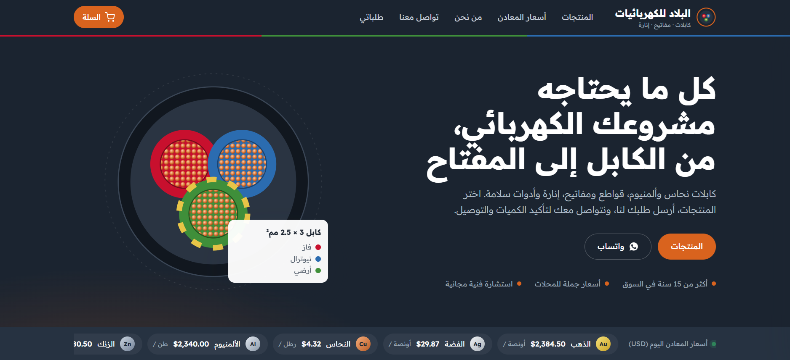
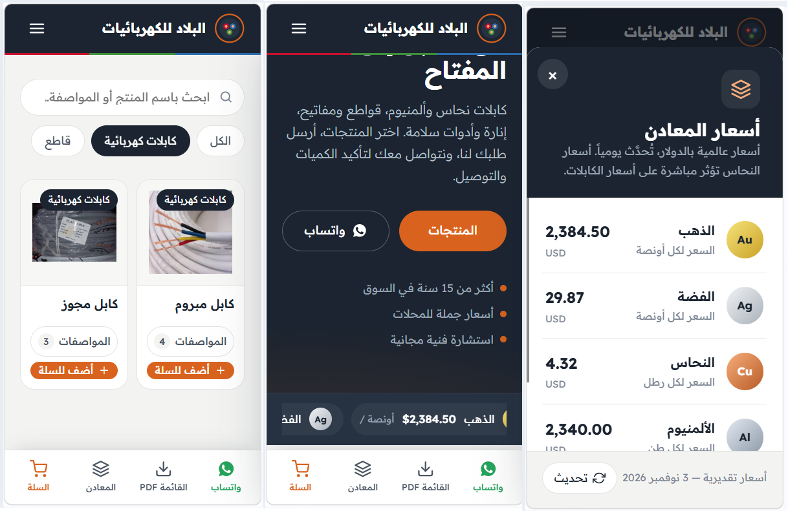

## About Laravel

Laravel is a web application framework with expressive, elegant syntax. We believe development must be an enjoyable and creative experience to be truly fulfilling. Laravel takes the pain out of development by easing common tasks used in many web projects, such as:

- [Simple, fast routing engine](https://laravel.com/docs/routing).
- [Powerful dependency injection container](https://laravel.com/docs/container).
- Multiple back-ends for [session](https://laravel.com/docs/session) and [cache](https://laravel.com/docs/cache) storage.
- Expressive, intuitive [database ORM](https://laravel.com/docs/eloquent).
- Database agnostic [schema migrations](https://laravel.com/docs/migrations).
- [Robust background job processing](https://laravel.com/docs/queues).
- [Real-time event broadcasting](https://laravel.com/docs/broadcasting).

Laravel is accessible, powerful, and provides tools required for large, robust applications.

## Learning Laravel

Laravel has the most extensive and thorough [documentation](https://laravel.com/docs) and video tutorial library of all modern web application frameworks, making it a breeze to get started with the framework.

You may also try the [Laravel Bootcamp](https://bootcamp.laravel.com), where you will be guided through building a modern Laravel application from scratch.

If you don't feel like reading, [Laracasts](https://laracasts.com) can help. Laracasts contains thousands of video tutorials on a range of topics including Laravel, modern PHP, unit testing, and JavaScript. Boost your skills by digging into our comprehensive video library.

## Laravel Sponsors

We would like to extend our thanks to the following sponsors for funding Laravel development. If you are interested in becoming a sponsor, please visit the [Laravel Partners program](https://partners.laravel.com).

### Premium Partners

- **[Vehikl](https://vehikl.com/)**
- **[Tighten Co.](https://tighten.co)**
- **[WebReinvent](https://webreinvent.com/)**
- **[Kirschbaum Development Group](https://kirschbaumdevelopment.com)**
- **[64 Robots](https://64robots.com)**
- **[Curotec](https://www.curotec.com/services/technologies/laravel/)**
- **[Cyber-Duck](https://cyber-duck.co.uk)**
- **[DevSquad](https://devsquad.com/hire-laravel-developers)**
- **[Jump24](https://jump24.co.uk)**
- **[Redberry](https://redberry.international/laravel/)**
- **[Active Logic](https://activelogic.com)**
- **[byte5](https://byte5.de)**
- **[OP.GG](https://op.gg)**

## Contributing

Thank you for considering contributing to the Laravel framework! The contribution guide can be found in the [Laravel documentation](https://laravel.com/docs/contributions).

## Code of Conduct

In order to ensure that the Laravel community is welcoming to all, please review and abide by the [Code of Conduct](https://laravel.com/docs/contributions#code-of-conduct).

## Security Vulnerabilities

If you discover a security vulnerability within Laravel, please send an e-mail to Taylor Otwell via [taylor@laravel.com](mailto:taylor@laravel.com). All security vulnerabilities will be promptly addressed.

## License

The Laravel framework is open-sourced software licensed under the [MIT license](https://opensource.org/licenses/MIT).

# 🏭 EL-BEELAD CABLES
### El-Beelad Cables Website

<a href="https://3lbeeldcable.infinityfreeapp.com/">

🌐 Visit Website
</a>

|

<a href="https://github.com/AbdullahAlwiAlshatry/El-Beeladcables">

💻 GitHub Repository

</a>

---

## 📖 About the Project

**El-Beelad Cables** is a website project dedicated to introducing the company and showcasing its digital identity through a well-organized online interface.

The project aims to provide a clear browsing experience and make the site accessible from computers and mobile phones.

## 📱 Mobile-Friendly Design

Attention has been paid to the display experience on various screens, including mobile phones, to facilitate browsing the site using different devices.

## 🖼️ Project Image Gallery

| View Website on Computer | View Website on Mobile |

| [View Image](https://github.com/AbdullahAlwiAlshatry/El-Beeladcables/blob/main/pictures%20project/Main.png) | [View Image](https://github.com/AbdullahAlwiAlshatry/El-Beeladcables/blob/main/pictures%20project/phone.png) |

## 🛠️ Technologies Used

- **Laravel 11**

- **PHP 8.2**

- **HTML**

- **CSS**

- **JavaScript**
  
- **MySQL** 

## 🚀 Visit the Project

You can visit the published version of the website via the following link:

**[El-Beelad Cables - Website](https://3lbeeldcable.infinityfreeapp.com/)**

## 💻 Source Code

The project is available on the GitHub repository:

[AbdullahAlwiAlshatry / El-Beeladcables](https://github.com/AbdullahAlwiAlshatry/El-Beeladcables)

## 👨‍💻 Developer

**Abdullah Alawi Alshateri**

